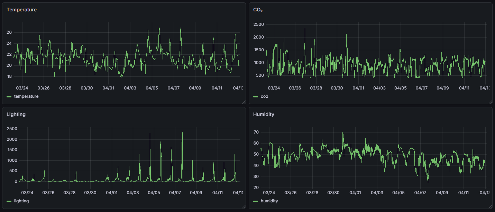

# pico-monitoring

Indoor CO2, temperature, humidity and light monitoring with Raspberry Pi Pico,
MQTT, FastAPI, PostgreSQL, React, Prometheus and Grafana.

## Bachelor's thesis and results

Developed by Artem Marynov as part of a bachelor's thesis at TUKE, this project
demonstrates continuous collection, storage and visualisation of indoor environmental data.
The Grafana results below show the recorded temperature, CO2, lighting and humidity
over the measurement period.



CSV analysis plots are saved in [`results/`](results/):
[time series](results/time_series.png), [distributions](results/distributions.png),
[box plots](results/boxplots.png), [correlations](results/correlation_matrix.png),
[daily averages](results/daily_averages.png), [hourly patterns](results/hourly_patterns.png)
and [pairwise relationships](results/pairwise_relationships.png).

## How it works

Pico publishes JSON measurements to a public MQTT broker. A local Mosquitto bridge
receives them; FastAPI validates, stores them in PostgreSQL and republishes cleaned
values for mqtt-exporter. Prometheus scrapes those metrics; React polls history
and sensor status every 10 seconds.
Grafana automatically loads live/historical charts and its data sources.
Notifier sends Apprise alerts for threshold violations, missing data and recovery.

Measurements become stale after `SENSOR_STALE_SECONDS` (default: 60 seconds).

## Quick start

Requires Docker. Create `.env` in the project root:

```dotenv
PG_USER=pico
PG_PASSWORD=<database-password>
PG_DB=metrics
MQTT_TOPIC=<MQTT_TOPIC>
MQTT_PASSWORD=<api-mqtt-password>
NOTIFIER_PASSWORD=<notifier-mqtt-password>
EXPORTER_PASSWORD=<exporter-mqtt-password>
GRAFANA_ADMIN_PASSWORD=<grafana-admin-password>
GRAFANA_DB_PASSWORD=<grafana-read-only-database-password>
SENSOR_STALE_SECONDS=60
NOTIFIER_APPRISE_URL=
```

Replace every `<...>`. Generate each secret separately with
`python -c "import secrets; print(secrets.token_urlsafe(36))"`.
For an existing Pico, set `MQTT_TOPIC` to its current topic; no firmware change is needed.
Optional Telegram notifications: `NOTIFIER_APPRISE_URL=tgram://BOT_TOKEN/CHAT_ID`.

```sh
docker compose up -d --build
```

| Interface | Local address |
| --- | --- |
| Metrics dashboard | http://localhost:5173 |
| API documentation | http://localhost:8000/docs |
| PostgreSQL | localhost:54827 |
| Prometheus | http://localhost:9091 |
| Grafana | http://localhost:3001/d/pico-environment |

## Device configuration

For a new device, create `firmware/secrets.py` and upload `firmware/` with `lib/`:

```python
secrets = {
    "ssid": "<wifi-name>",
    "password": "<wifi-password>",
    "MQTT_BROKER": "test.mosquitto.org",
    "MQTT_PORT": 1883,
    "CLIENT_ID": "<unique-device-id>",
    "TOPIC_SENSOR": b"<MQTT_TOPIC>",
}
```

Topics use slash-separated letters, numbers, underscores and hyphens. The public
broker does not provide confidentiality or authenticity; messages can be read or
spoofed. Use this deployment on a trusted LAN.

## Checks

- Python 3.13: `pip install -r requirements-dev.txt`, then `ruff check .` and `pytest -q`.
  Database tests require `TEST_DATABASE_URL` pointing to a disposable database.
- Frontend: in `frontend/`, run `npm ci`, `npm run lint`, `npm test`, `npm run build`.
- End-to-end: `python scripts/smoke_test.py` runs an isolated stack and cleans it up.
